# Звіт з лабораторної роботи 1

## Тема роботи: Розроблення backend архітектури та основного функціоналу

Здобувач освіти: [Генелюк Назар Олексійович]
Група: [ІПЗ-42]

Предметна область: **Система обліку відвідуваності студентів**.

## Виконання роботи

### Налаштування проєкту
- Створено Git репозиторій [WebDev-labs](https://github.com/Worgzz333r/WebDev-labs), робота виконана в папці `lab-01`.
- Ініціалізовано Node.js проєкт (`npm init`).
- Встановлено залежності: `express`, `cors`, `dotenv`, `@prisma/client`, `@prisma/adapter-pg`, `pg`, `bcrypt`, `zod`; для розробки `prisma`, `nodemon`. Версії `prisma` і `@prisma/client` узгоджені (7.10.1).
- Налаштовано структуру файлів: `src/controllers`, `src/models`, `src/routes`, `src/utils`, `prisma`, `reports`.
- Налаштовано змінні середовища у файлі `.env` (`PORT`, `DATABASE_URL`). Файл додано в `.gitignore`, у репозиторій він не потрапляє.

### База даних
- Налаштовано PostgreSQL 18, створено базу `attendance`.
- Створено Prisma схему (`prisma/schema.prisma`) з 7 моделями та 2 enum-типами:
  - `Group`, `User`, `Subject`, `TeacherSubject`, `Lesson`, `Attendance`, `Document`;
  - `Role` (`ADMIN`, `TEACHER`, `STUDENT`), `AttendanceStatus` (`PRESENT`, `ABSENT`, `LATE`, `EXCUSED`).
- Типи зв'язків:
  - один-до-багатьох: `Group` → `User`, `Subject` → `Lesson`, `Lesson` → `Attendance`, `User` → `Attendance`;
  - багато-до-багатьох: викладач ↔ предмет через `TeacherSubject`;
  - один-до-одного: `Attendance` ↔ `Document` (довідка до пропуску).
- Унікальність пари `(lessonId, studentId)` не дозволяє відмітити студента на одній парі двічі.
- Виконано міграцію `init` (`npx prisma migrate dev --name init`).

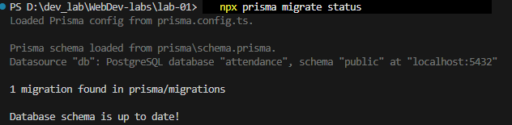

### Backend архітектура
- Створено Express.js сервер (`src/app.js`).
- Реалізовано MVC-підхід: маршрути (`routes`) приймають запит, контролери (`controllers`) містять логіку, роль моделі виконує Prisma ORM (схема в `prisma/schema.prisma`, клієнт у `src/utils/prisma.js`). Представлення (View) відсутнє, бо API повертає JSON.
- Впроваджено middleware:
  - `cors` та `express.json()` для обробки запитів;
  - `validate` (zod) для перевірки тіла запиту, схеми в `src/utils/schemas.js`;
  - `router.param('id')` для перевірки id в URL;
  - обробник неіснуючих маршрутів (404);
  - централізований обробник помилок `src/utils/errorHandler.js`, який перетворює помилки Prisma на HTTP-статуси (`P2025` → 404, `P2002` → 409, `P2003` → 400).
- Паролі користувачів хешуються через `bcrypt`, поле `password` не повертається у відповідях API.

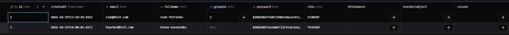

### API endpoints
Базовий URL: `http://localhost:3000/api`. Повна документація з прикладами запитів і відповідей у [README.md](../README.md).

| Ресурс | Endpoints |
|---|---|
| Health | `GET /health` |
| Групи | `GET /groups`, `GET /groups/:id`, `POST /groups`, `PUT /groups/:id`, `DELETE /groups/:id` |
| Предмети | `GET /subjects`, `GET /subjects/:id`, `POST /subjects`, `PUT /subjects/:id`, `DELETE /subjects/:id` |
| Користувачі | `GET /users`, `GET /users/:id`, `POST /users`, `PUT /users/:id`, `DELETE /users/:id` |
| Пари | `GET /lessons` (фільтри `groupId`, `subjectId`), `GET /lessons/:id`, `POST /lessons`, `PUT /lessons/:id`, `DELETE /lessons/:id` |
| Відвідуваність | `GET /attendance` (фільтри `lessonId`, `studentId`), `GET /attendance/:id`, `POST /attendance`, `PUT /attendance/:id`, `DELETE /attendance/:id` |

## Структура проєкту

```
lab-01/
├── src/
│   ├── controllers/
│   │   ├── groupController.js
│   │   ├── subjectController.js
│   │   ├── userController.js
│   │   ├── lessonController.js
│   │   └── attendanceController.js
│   ├── models/
│   ├── routes/
│   │   ├── groupRoutes.js
│   │   ├── subjectRoutes.js
│   │   ├── userRoutes.js
│   │   ├── lessonRoutes.js
│   │   └── attendanceRoutes.js
│   ├── utils/
│   │   ├── prisma.js
│   │   ├── validate.js
│   │   ├── schemas.js
│   │   └── errorHandler.js
│   └── app.js
├── prisma/
│   ├── migrations/
│   └── schema.prisma
├── reports/
│   └── lab1-report.md
├── prisma.config.ts
├── .env
├── .gitignore
├── package.json
└── README.md
```

## Скріншоти тестування

### Запуск сервера
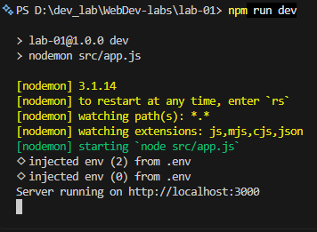

### CRUD операції

Група:
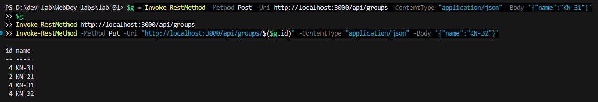

Предмет:
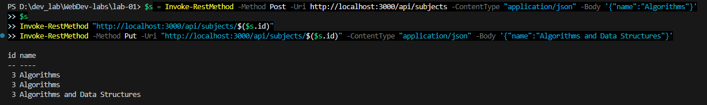

Користувач (відповідь без поля `password`):
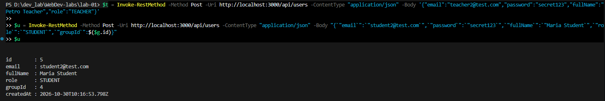

Пара:
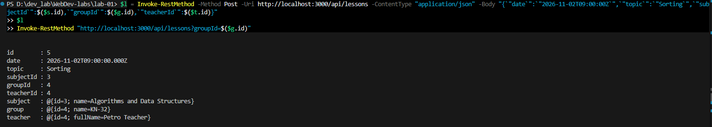

Відмітка відвідуваності:
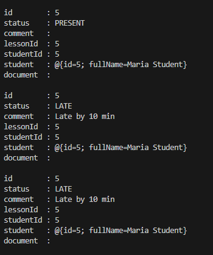

### Валідація і обробка помилок
- 400, помилка валідації з `details`:
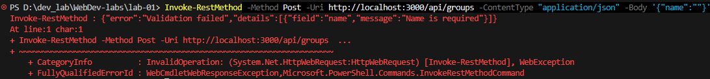

- 400, некоректний id:
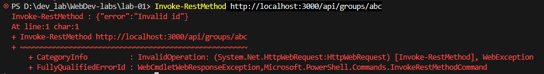в

- 404, запис не знайдено:
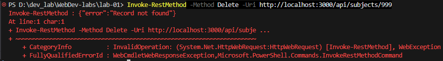

- 409, дублікат:
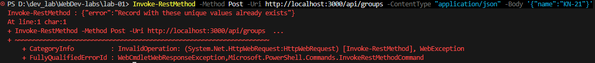

## Висновки

У ході роботи створено backend для системи обліку відвідуваності студентів на Node.js, Express.js та PostgreSQL з використанням Prisma ORM. Спроєктовано схему з 7 таблиць та різними типами зв'язків (1:N, M:N, 1:1), реалізовано CRUD для пяти сутностей, валідацію вхідних даних через zod, централізовану обробку помилок, хешування паролів і конфігурацію через змінні середовища. Створено документацію API у README.md.

Самооцінка: [5]

Обгрунтування: [виконано всі вимоги для оцінки відмінно]
