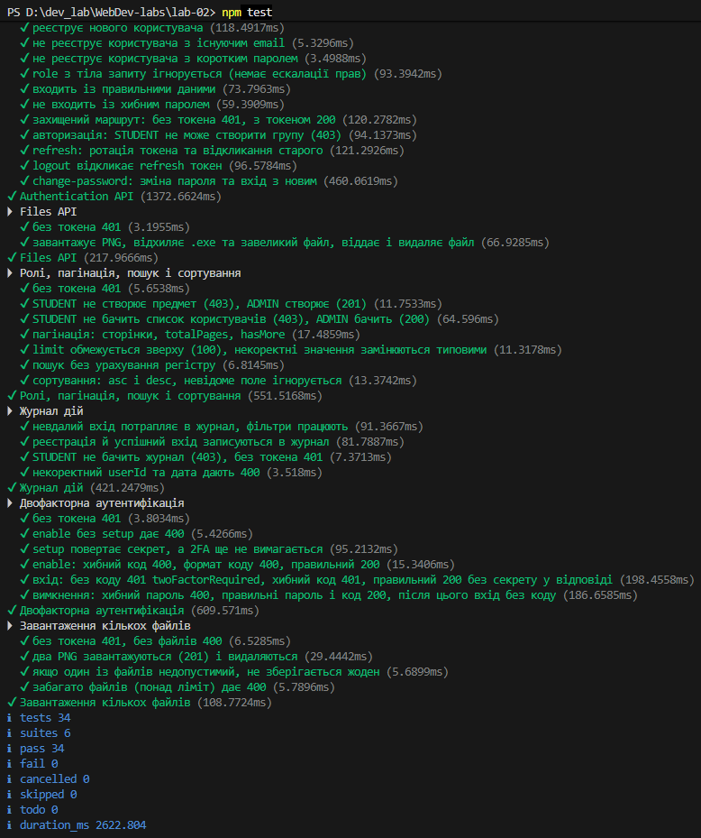

# Звіт про виконання лабораторної роботи №2

**Тема:** Аутентифікація, авторизація та розширений функціонал
**Дисципліна:** Веб-розробка
**Виконав:** [Генелюк Назар Олексійович]
**Група:** [ІПЗ-42]
**Предметна область:** система обліку відвідуваності студентів
**Репозиторій:** https://github.com/Worgzz333r/WebDev-labs/tree/lab-02

---

## 1. Мета роботи

Реалізувати аутентифікацію та авторизацію користувачів, безпечне зберігання паролів і керування токенами; розширити серверний застосунок файловим сервісом, пошуком, фільтрацією та пагінацією; створити документацію API.

## 2. Стек

Node.js, Express 5, PostgreSQL, Prisma ORM 7, zod (валідація), argon2 (хешування), jsonwebtoken, multer 2.x, helmet, cors, express-rate-limit, swagger-jsdoc + swagger-ui-express, node:test + supertest.

## 3. Виконані завдання

### Рівень 1

| Завдання | Реалізація |
|---|---|
| Реєстрація з валідацією | `POST /api/auth/register`, схема `registerSchema` (zod): email, пароль 8–128 символів, `fullName` |
| Argon2id | `src/utils/password.js`, `argon2.hash(..., { type: argon2.argon2id })` |
| JWT-аутентифікація | `src/utils/jwt.js`: access-токен (`JWT_SECRET`) та refresh-токен (`REFRESH_TOKEN_SECRET`) |
| Middleware аутентифікації | `src/middleware/auth.js`: перевіряє `Authorization: Bearer ...`, кладе дані в `req.user` |
| Ролі | `ADMIN`, `TEACHER`, `STUDENT` (enum `Role` у Prisma) |
| Middleware авторизації | `src/middleware/authorize.js`: `authorize('ADMIN', 'TEACHER')`, відповідь 403 за браку прав |
| Пагінація | `src/utils/query.js`: `page`, `limit` (максимум 100), відповідь з `total`, `totalPages`, `hasMore` |
| Swagger | `src/config/swagger.js`, документація за адресою `/api-docs` |

### Рівень 2

| Завдання | Реалізація |
|---|---|
| Файловий сервіс | `POST /api/files/upload`, `GET /api/files/:id`, `DELETE /api/files/:id` |
| Валідація файлів | дозволені `jpeg`, `png`, `gif`, `pdf`; MIME-тип і розширення мають збігатися; ліміт розміру 5 МБ (`MAX_FILE_SIZE`); один файл за запит; ім'я на диску генерується сервером |
| Пошук | `search` у пар (за темою), предметів (за назвою), відвідуваності (за ПІБ студента) |
| Фільтрація | пари: `subjectId`, `groupId`, `teacherId`, `dateFrom`, `dateTo`; відвідуваність: `lessonId`, `studentId`, `status`, `dateFrom`, `dateTo` |
| Оновлення й видалення файлів | видалення з диску та БД; доступ лише власнику або `ADMIN` |
| Зміна пароля | `POST /api/auth/change-password`, після зміни всі refresh-токени користувача відкликаються |
| Refresh-токени з відкликанням | у БД зберігається SHA-256 хеш токена (`RefreshToken`), ротація при кожному `refresh`, `logout` відкликає токен |
| Тести | `tests/auth.test.js`, 13 тестів |

### Рівень 3 (частково)

| Завдання | Реалізація |
|---|---|
| Rate limiting | `express-rate-limit` на `/api/`: 100 запитів за 15 хвилин з однієї IP (налаштовується `RATE_LIMIT_MAX`) |
| Захист заголовків і CORS | `helmet`, `cors` з origin із `FRONTEND_URL` |

## 4. Структура проєкту

```
lab-02/
├── prisma/            # схема та міграції
├── scripts/           # create-admin.js
├── src/
│   ├── config/        # swagger.js
│   ├── controllers/
│   ├── middleware/    # auth, authorize, upload
│   ├── routes/
│   ├── utils/         # jwt, password, query, schemas, validate, errorHandler
│   ├── app.js
│   └── server.js
├── tests/             # auth.test.js
├── reports/
└── requests.http      # приклади запитів
```

## 5. Модель даних

До моделей лабораторної №1 додано:

- `User.password`, `User.role`;
- `File` (`filename`, `originalName`, `mimetype`, `size`, `path`, `uploadedBy`) і зв'язок `Document` ↔ `File`;
- `RefreshToken` (`tokenHash`, `userId`, `expiresAt`, `revokedAt`).

Міграції: `20261029125552_init`, `20261101162627_add_auth_and_files`.

## 6. Матриця доступу

| Ресурс | Операція | Ролі |
|---|---|---|
| `/groups`, `/subjects` | читання | будь-який автентифікований |
| `/groups`, `/subjects` | створення, зміна, видалення | `ADMIN` |
| `/users` | читання | `ADMIN`, `TEACHER` |
| `/users` | створення, зміна, видалення | `ADMIN` |
| `/lessons` | читання | будь-який автентифікований |
| `/lessons` | створення, зміна, видалення | `ADMIN`, `TEACHER` |
| `/attendance` | читання | усі ролі |
| `/attendance` | створення, зміна, видалення | `ADMIN`, `TEACHER` |
| `/attendance/:id/document` | прикріпити довідку | `STUDENT` |
| `/files/:id` | перегляд | власник, `ADMIN`, `TEACHER` |
| `/files/:id` | видалення | власник, `ADMIN` |

## 7. Безпека

- Паролі хешуються Argon2id, сіль зберігається всередині хеша.
- Публічна реєстрація завжди створює `STUDENT`: поле `role` із тіла запиту ігнорується, тому підвищити собі права неможливо. Адміністратора створює скрипт `npm run seed:admin`.
- Однакова відповідь 401 для неіснуючого email і хибного пароля, щоб не розкривати наявність облікового запису.
- Refresh-токени зберігаються лише у вигляді хеша; повторне використання відкликаного токена скасовує всі токени користувача.
- Поле `password` ніколи не повертається клієнту.
- Сортування лише за білим списком полів, `limit` обмежений, `id` у маршрутах валідуються.
- Для файлів перевіряються MIME-тип, розширення та розмір; оригінальне ім'я не використовується як шлях.
- Секрети та параметри лежать у `.env`, який виключено з git.

## 8. Тестування

Команда: `npm test` (`node --test`, бібліотека `supertest`, реальна БД PostgreSQL).

| Набір | Перевірка |
|---|---|
| Authentication API | реєстрація; дублікат email (409); короткий пароль (400); ігнорування `role` з тіла; вхід; хибний пароль (401); доступ без токена (401) і з токеном (200); `STUDENT` не створює групу (403); ротація refresh-токена та реакція на повторне використання; `logout`; зміна пароля |
| Files API | без токена 401; завантаження PNG; відхилення `.exe`; відхилення файлу понад 5 МБ; отримання та видалення файлу |

Результат: 13 тестів, 13 пройдено, 0 помилок.



## 9. Документація API

Swagger UI доступний за адресою `http://localhost:3000/api-docs`. Описано всі ендпоінти з прикладами тіл запитів і відповідей, схеми безпеки (Bearer JWT) та коди помилок. Також є файл `requests.http` з готовими запитами.


## 10. Запуск

```bash
npm install
npx prisma migrate dev
npm run seed:admin
npm run dev
```

Змінні середовища (`.env`):

| Змінна | Призначення |
|---|---|
| `PORT` | порт сервера |
| `DATABASE_URL` | підключення до PostgreSQL |
| `JWT_SECRET`, `JWT_EXPIRES_IN` | підпис і термін життя access-токена |
| `REFRESH_TOKEN_SECRET`, `REFRESH_TOKEN_EXPIRES_IN` | підпис і термін життя refresh-токена |
| `FRONTEND_URL` | дозволений origin для CORS |
| `RATE_LIMIT_MAX` | ліміт запитів за 15 хвилин |
| `UPLOAD_DIR`, `MAX_FILE_SIZE` | каталог та ліміт розміру файлів |
| `ADMIN_EMAIL`, `ADMIN_PASSWORD` | дані адміністратора для `seed:admin` |

## 11. Скріншоти

1. Застосування міграцій: `screenshots/migration.png`, `migration2.png`, `migration3.png`.
2. Swagger UI: `screenshots/swagger.png`.
3. Реєстрація та вхід (відповідь із токенами): `screenshots/login.png`.
4. Відповідь 403 для `STUDENT`: `screenshots/forbidden.png`.
5. Завантаження файлу та відхилення `.exe`: `screenshots/upload.png`.
6. Результат `npm test`: `screenshots/tests.png`.

## 12. Висновки

У ході роботи реалізовано повний цикл аутентифікації та авторизації: реєстрацію, вхід, пару access/refresh токенів із ротацією та відкликанням, рольову модель і захист маршрутів. Додано файловий сервіс із валідацією, пошук, фільтрацію й пагінацію, rate limiting, helmet та CORS. API задокументовано в Swagger і покрито автоматичними тестами. Реалізація відповідає вимогам рівнів 1 і 2 та частково рівня 3.
