# Звіт з лабораторної роботи 2

## Тема роботи: Аутентифікація, авторизація та розширений функціонал

Здобувач освіти: [Генелюк Назар Олексійович]
Група: [ІПЗ-42]
GitHub репозиторій: [https://github.com/Worgzz333r/WebDev-labs/tree/lab-02]
Рівень складності: [3]

## Реалізований функціонал

Предметна область: система обліку відвідуваності студентів. Стек: Node.js, Express 5, PostgreSQL, Prisma 7, zod, argon2, jsonwebtoken, multer 2.x, helmet, cors, express-rate-limit, swagger-jsdoc + swagger-ui-express, node:test + supertest. Інструкція із запуску та змінні середовища описані в `README.md`.

### Рівень 1

- Реєстрація з валідацією (`POST /api/auth/register`, zod-схема: email, пароль 8–128 символів, `fullName`). Публічна реєстрація завжди створює `STUDENT`, поле `role` із запиту ігнорується.
- Хешування паролів Argon2id (`src/utils/password.js`).
- JWT-аутентифікація: access-токен і refresh-токен із різними секретами (`src/utils/jwt.js`).
- Middleware аутентифікації `authenticate` (`src/middleware/auth.js`).
- Ролі `ADMIN`, `TEACHER`, `STUDENT` (enum `Role` у Prisma).
- Middleware авторизації `authorize(...ролі)` (`src/middleware/authorize.js`): 401 без автентифікації, 403 за браку прав.
- Пагінація (`src/utils/query.js`): `page`, `limit` (максимум 100), у відповіді `total`, `totalPages`, `hasMore`.
- Swagger: `/api-docs`, описано всі ендпоінти зі схемами, прикладами та кодами помилок.

### Рівень 2

- Файловий сервіс: `POST /api/files/upload`, `GET /api/files/:id`, `PUT /api/files/:id`, `DELETE /api/files/:id`.
- Валідація файлів: дозволені `jpeg`, `png`, `gif`, `pdf`; MIME-тип і розширення мають збігатися; ліміт розміру 5 МБ (`MAX_FILE_SIZE`); ім'я на диску генерується сервером.
- Оновлення файлу (`PUT /api/files/:id`): заміна вмісту з тією ж валідацією та/або перейменування; старий файл видаляється з диска; доступ лише власнику або `ADMIN`.
- Пошук: `search` для пар (за темою), предметів (за назвою), користувачів (ПІБ, email), відвідуваності (ПІБ студента).
- Фільтрація: пари (`subjectId`, `groupId`, `teacherId`, `dateFrom`, `dateTo`), відвідуваність (`lessonId`, `studentId`, `status`, `dateFrom`, `dateTo`), користувачі (`role`, `groupId`); сортування за білим списком полів.
- Зміна пароля (`POST /api/auth/change-password`): після зміни всі refresh-токени користувача відкликаються.
- Refresh-токени з відкликанням: у БД лежить лише SHA-256 хеш, при кожному `refresh` відбувається ротація, `logout` відкликає токен, повторне використання відкликаного токена скасовує всі токени користувача.
- Автотести: `tests/auth.test.js` (13) і `tests/features.test.js` (29), разом 42.

### Рівень 3

- Двофакторна аутентифікація (TOTP, RFC 6238, без зовнішніх залежностей, `src/utils/totp.js`): `POST /api/auth/2fa/setup`, `/enable`, `/disable`; `login` приймає поле `code`; вимкнення потребує пароль і код.
- Логування дій користувачів: модель `AuditLog`, `src/utils/audit.js`; записуються входи (у т.ч. невдалі), вихід, зміна пароля, 2FA, операції з файлами та відвідуваністю; перегляд `GET /api/audit-logs` (лише `ADMIN`) з пагінацією та фільтрами.
- Rate limiting: загальний ліміт на `/api/` (100 запитів за 15 хвилин) і окремий ліміт невдалих спроб на `/auth/login`, `/refresh`, `/change-password`, `/2fa/*` (20 за 15 хвилин, успішні запити ліміт не витрачають).
- Завантаження кількох файлів: `POST /api/files/upload-multiple`, до 5 файлів, «усе або нічого».
- Також: `helmet`, CORS з origin із `FRONTEND_URL`.
- Не виконано: відновлення пароля через email, вхід через OAuth, деталізована система дозволів.

### Матриця доступу

| Ресурс | Операція | Ролі |
|---|---|---|
| `/groups`, `/subjects` | читання | будь-який автентифікований |
| `/groups`, `/subjects` | створення, зміна, видалення | `ADMIN` |
| `/users` | читання | `ADMIN`, `TEACHER` |
| `/users` | створення, зміна, видалення | `ADMIN` |
| `/lessons` | читання | будь-який автентифікований |
| `/lessons` | створення, зміна, видалення | `ADMIN`, `TEACHER` |
| `/attendance` | читання | усі ролі (`STUDENT` бачить лише свої записи) |
| `/attendance` | створення, зміна, видалення | `ADMIN`, `TEACHER` |
| `/attendance/:id/document` | прикріпити довідку | `STUDENT` (лише до власного запису) |
| `/files/:id` | перегляд | власник, `ADMIN`, `TEACHER` |
| `/files/:id` | оновлення, видалення | власник, `ADMIN` |
| `/audit-logs` | читання журналу | `ADMIN` |

### Безпека

- Паролі хешуються Argon2id, сіль зберігається всередині хеша; `password` і секрет 2FA не повертаються клієнту.
- Однакова відповідь 401 для неіснуючого email і хибного пароля.
- Refresh-токени зберігаються лише як хеш; повторне використання відкликаного токена скасовує всі токени користувача.
- Зміна пароля або ролі адміном відкликає refresh-токени користувача (вже виданий access-токен діє до 15 хвилин).
- Сортування лише за білим списком полів, `limit` обмежений, `id` у маршрутах валідуються.
- Для файлів перевіряються MIME-тип, розширення та розмір; оригінальне ім'я не використовується як шлях.
- Секрети лежать у `.env`, який виключено з git; шаблон у `.env.example`.

### Тестування

Команда `npm test` (`node --test`, `supertest`, реальна БД PostgreSQL). Покрито: реєстрацію, вхід, ролі й 401/403, ротацію та відкликання refresh-токенів, зміну пароля, файли (завантаження, відхилення `.exe` і завеликого файлу, оновлення, видалення, права доступу), пагінацію, пошук, сортування, журнал дій, 2FA, завантаження кількох файлів, відкликання сесій при зміні ролі адміном. Результат: 42 тести, 42 пройдено, 0 помилок. CRUD груп, предметів, пар і користувачів перевірявся вручну запитами з `requests.http`.

## Ключові фрагменти коду

Хешування й перевірка пароля (Argon2id), `src/utils/password.js`:

```javascript
export function hashPassword(password) {
  return argon2.hash(password, { type: argon2.argon2id });
}

export function comparePassword(password, hash) {
  return argon2.verify(hash, password);
}
```

Middleware авторизації за ролями, `src/middleware/authorize.js`:

```javascript
export function authorize(...allowedRoles) {
  return (req, res, next) => {
    if (!req.user) {
      return res.status(401).json({ error: 'Необхідна аутентифікація' });
    }
    if (!allowedRoles.includes(req.user.role)) {
      return res.status(403).json({ error: 'Недостатньо прав для виконання цієї операції' });
    }
    next();
  };
}
```

Ротація refresh-токена та виявлення повторного використання, `src/controllers/authController.js`:

```javascript
if (!stored || stored.revokedAt) {
  // Повторне використання відкликаного токена: відкликаємо всі токени користувача
  if (stored) {
    await prisma.refreshToken.updateMany({
      where: { userId: stored.userId, revokedAt: null },
      data: { revokedAt: new Date() },
    });
    await logAction(req, 'REFRESH_TOKEN_REUSE', { userId: stored.userId });
  }
  return res.status(401).json({ error: 'Недійсний refresh токен' });
}

// Ротація: старий токен відкликаємо, видаємо нову пару
await prisma.refreshToken.update({
  where: { id: stored.id },
  data: { revokedAt: new Date() },
});
res.json({ tokens: await issueTokens(stored.user) });
```

Валідація файлів: MIME-тип і розширення мають збігатися, `src/middleware/upload.js`:

```javascript
const allowedTypes = new Map([
  ['image/jpeg', ['.jpg', '.jpeg']],
  ['image/png', ['.png']],
  ['image/gif', ['.gif']],
  ['application/pdf', ['.pdf']],
]);

const fileFilter = (req, file, cb) => {
  const ext = path.extname(file.originalname).toLowerCase();
  if (allowedTypes.get(file.mimetype)?.includes(ext)) {
    cb(null, true);
  } else {
    const error = new Error('Непідтримуваний тип файлу');
    error.status = 400;
    cb(error);
  }
};
```

Окремий ліміт невдалих спроб на auth-маршрутах, `src/app.js`:

```javascript
const authLimiter = rateLimit({
  windowMs: 15 * 60 * 1000,
  limit: Number(process.env.AUTH_RATE_LIMIT_MAX) || 20,
  skipSuccessfulRequests: true,
  standardHeaders: 'draft-8',
  legacyHeaders: false,
  message: { error: 'Забагато невдалих спроб, спробуйте пізніше' },
});
app.use(
  ['/api/auth/login', '/api/auth/refresh', '/api/auth/change-password', '/api/auth/2fa'],
  authLimiter,
);
```

Перевірка TOTP-коду зі зсувом ±30 с і порівнянням за сталий час, `src/utils/totp.js`:

```javascript
export function verifyTotp(secret, code, time = Date.now(), window = 1) {
  if (typeof code !== 'string' || !/^\d{6}$/.test(code)) return false;
  const key = base32Decode(secret);
  const counter = Math.floor(time / 1000 / STEP_SECONDS);
  const given = Buffer.from(code);

  for (let shift = -window; shift <= window; shift += 1) {
    if (timingSafeEqual(Buffer.from(hotp(key, counter + shift)), given)) return true;
  }
  return false;
}
```

## Скріншоти

Застосування міграцій:

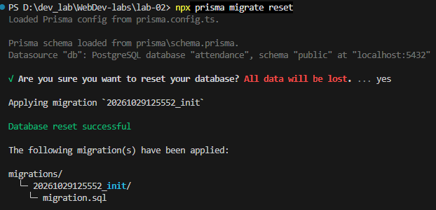

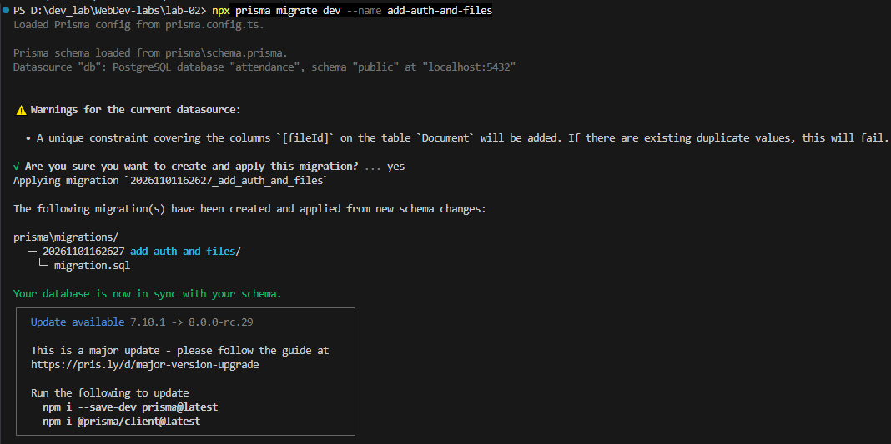

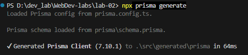

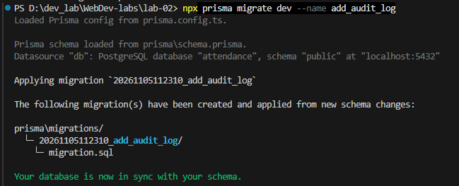

Swagger UI (`/api-docs`):

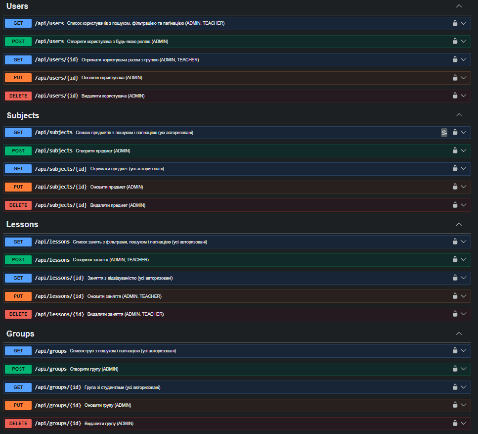

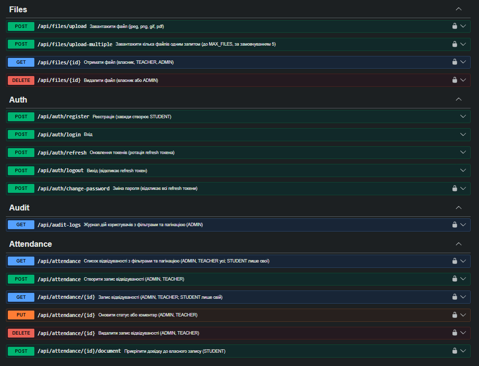

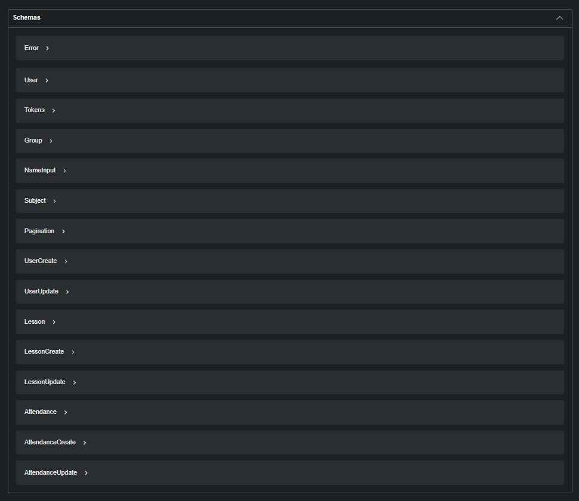

Реєстрація та вхід (відповідь із токенами):

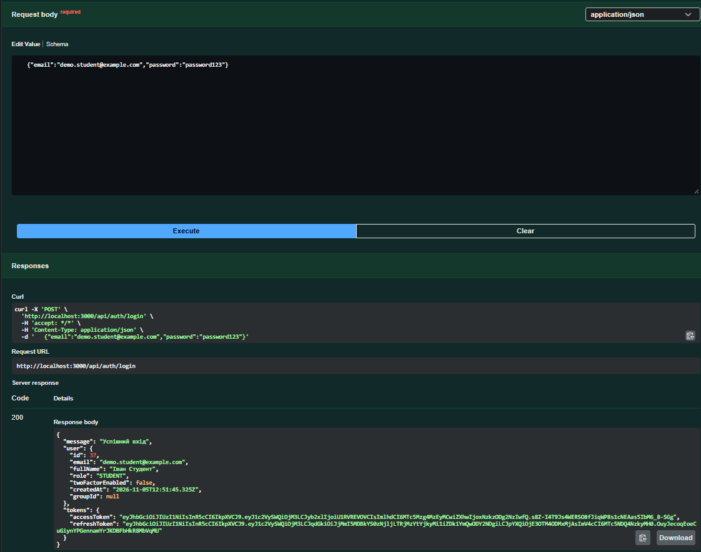

Відповідь 403 для `STUDENT`:

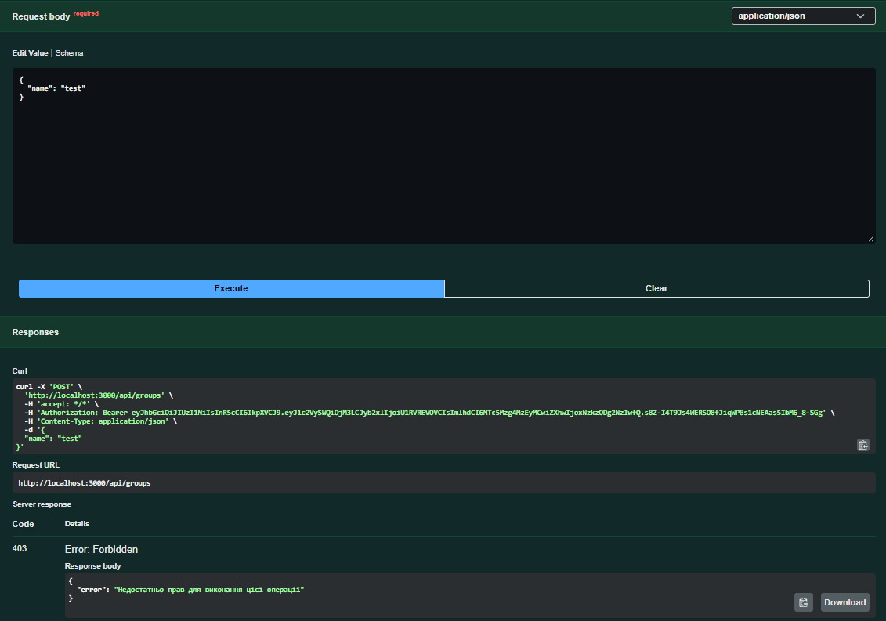

Завантаження файлу:

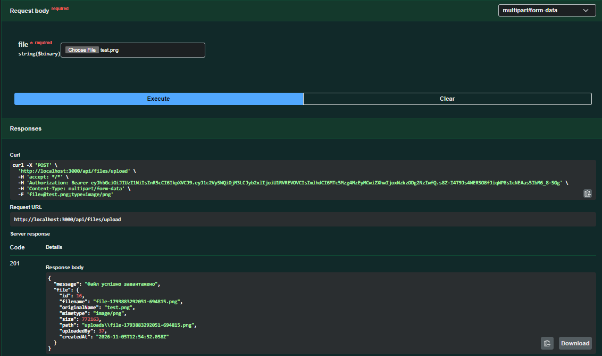

Оновлення файлу (`PUT /api/files/:id`):

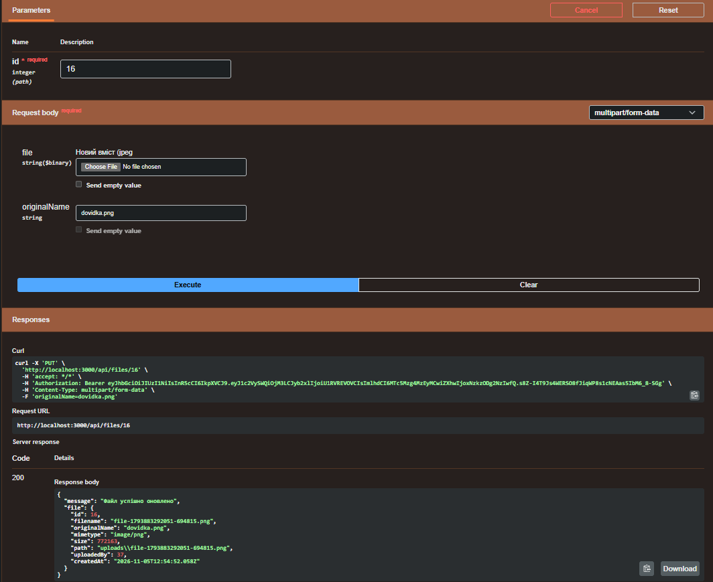

Завантаження кількох файлів:

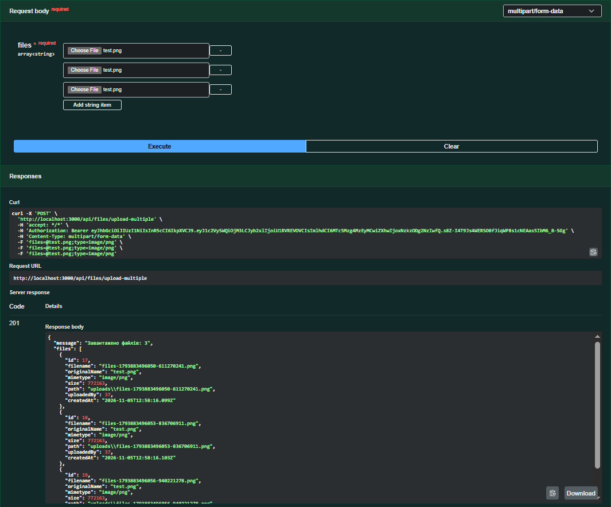

Журнал дій (`GET /api/audit-logs`):

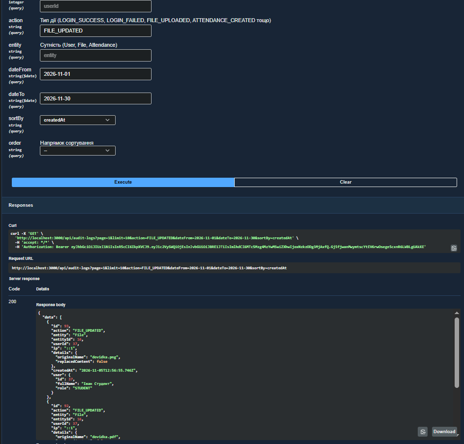

Двофакторна аутентифікація (вхід без коду та з кодом):

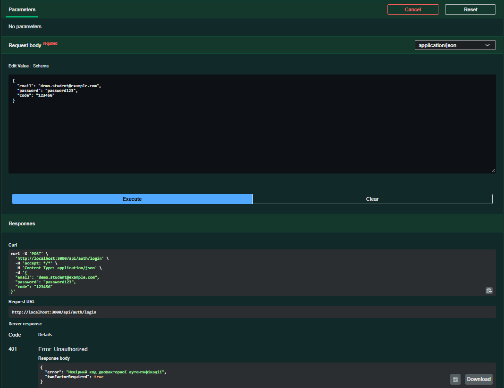
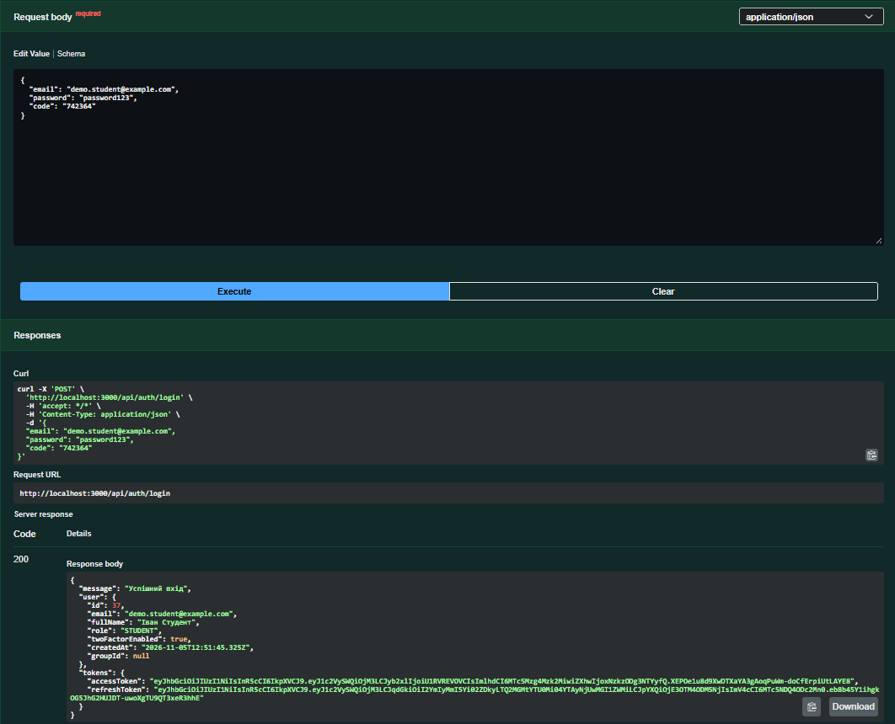

Результат `npm test`:

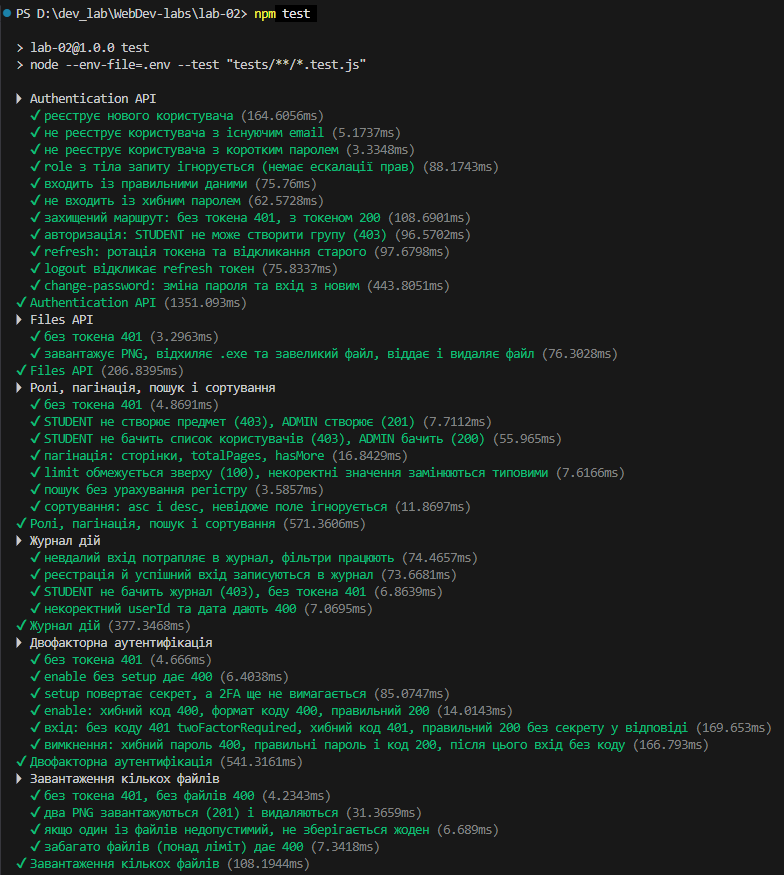
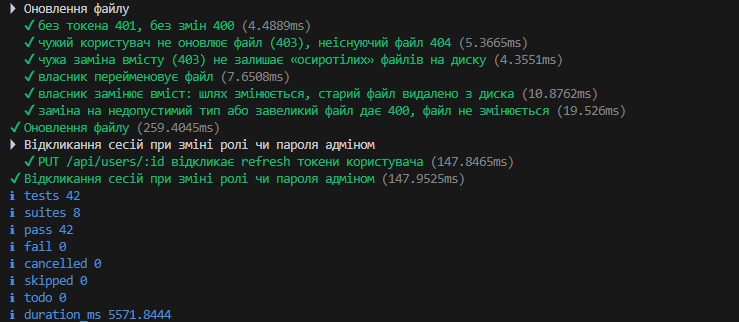

## Висновки

Самооцінка: [5]

Обґрунтування: [виконано всі завдання рівнів 1 і 2. З рівня 3 реалізовано чотири пункти з восьми: 2FA, журнал дій, rate limiting, завантаження кількох файлів. Паролі хешуються Argon2id, refresh-токени мають ротацію та відкликання, роботу покрито 42 автоматичними тестами, документація Swagger описує всі ендпоінти. Не реалізовано відновлення пароля через email, OAuth і детальну систему дозволів, а CRUD груп, предметів, пар і користувачів перевірявся вручну.]
