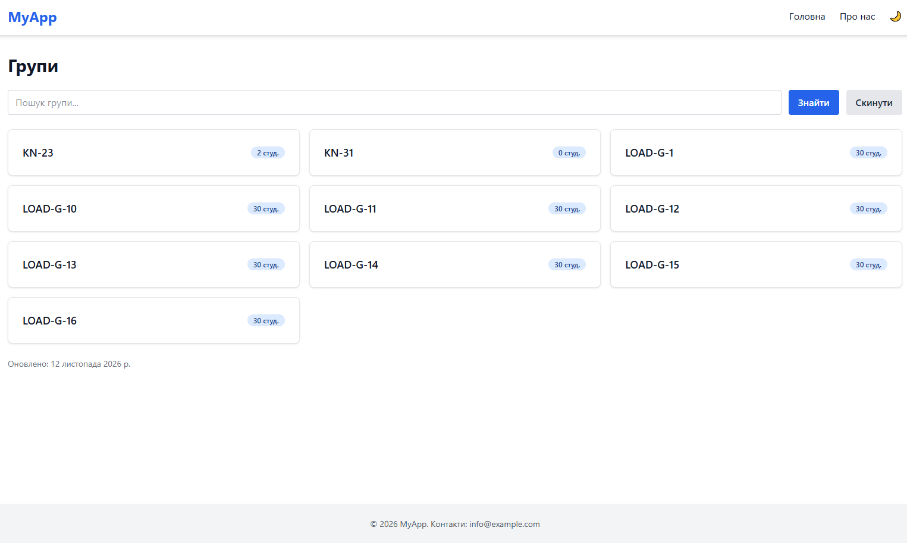
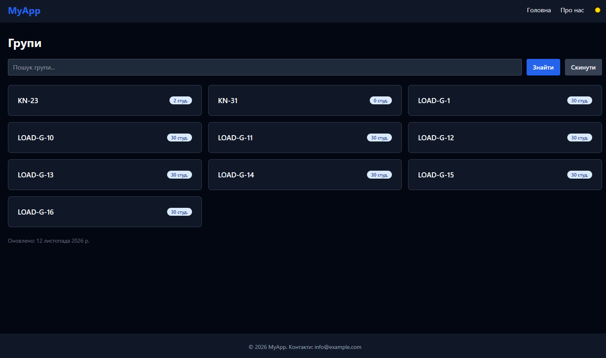

# WebDev Client (lab-04)

## Опис проєкту
Клієнтська частина (React) для серверної системи з лабораторних робіт 1-3. На цьому етапі: каркас проєкту, інструменти розробки, базові UI-компоненти, маршрутизація, Axios, темна тема.

## Технології
- React 19
- TypeScript
- Vite
- Tailwind CSS 4
- React Router 8
- Axios
- ESLint + Prettier

## Встановлення та запуск

### Вимоги
- Node.js 24 LTS
- npm

### Інструкції
```bash
git clone https://github.com/Worgzz333r/WebDev-labs.git
cd WebDev-labs/lab-04
npm install
cp .env.example .env
npm run dev
npm run build
```

## Змінні середовища

| Змінна | Опис | Приклад |
|--------|------|---------|
| `VITE_API_URL` | Адреса API серверної частини (лаб. 1-3) | `http://localhost:3000/api` |
| `VITE_APP_NAME` | Назва застосунку | `MyApp` |

Для роботи сторінки «Групи» потрібен запущений бекенд. Ендпоінт `GET /api/groups` вимагає авторизації, тому без токена сторінка показує повідомлення про необхідність входу (сторінку входу буде додано в наступній лабораторній роботі).

## Структура проєкту
```
src/
├── components/
│   ├── common/      # Button, Input, Card, Badge, Loading, ErrorBoundary
│   └── layout/      # Header, Footer, Layout
├── pages/           # HomePage, AboutPage, NotFoundPage
├── services/        # Axios (api.ts) з interceptors
├── types/           # Типи відповідей API
├── utils/           # Функції форматування
├── hooks/           # useTheme
└── constants/       # Константи застосунку
```

## Компоненти

Усі компоненти приймають стандартні HTML-атрибути відповідного елемента (`ComponentProps`).

### Button
Props: `variant` (`primary` | `secondary` | `danger`), `size` (`sm` | `md` | `lg`), `isLoading`.
```tsx
<Button variant="danger" size="sm" onClick={handleDelete}>Видалити</Button>
<Button isLoading={isSaving}>Зберегти</Button>
```

### Input
Звичайний `<input>` зі стилями й темною темою; `ref` передається як проп (React 19).
```tsx
<Input placeholder="Пошук..." value={query} onChange={(e) => setQuery(e.target.value)} />
```

### Card
Контейнер із рамкою та тінню.
```tsx
<Card><h2>Заголовок</h2><p>Вміст</p></Card>
```

### Badge
Props: `variant` (`info` | `success` | `warning` | `danger`).
```tsx
<Badge variant="success">Активний</Badge>
```

### Loading
Props: `label` (необов'язковий).
```tsx
{isLoading && <Loading label="Завантаження користувачів..." />}
```

### ErrorBoundary
Перехоплює помилки відтворення дочірніх компонентів; `fallback` задає власний запасний UI.
```tsx
<ErrorBoundary fallback={<p>Помилка</p>}><Outlet /></ErrorBoundary>
```

### useTheme
Хук повертає `{ theme, toggleTheme }`, вибір зберігається в `localStorage`.

## Утиліти
- `formatDate(iso, locale?)`: дата у форматі «12 листопада 2026 р.»
- `formatPrice(value, currency?, locale?)`: сума у гривнях
- `getErrorMessage(error)`: зрозуміле повідомлення з помилки Axios

## Скріншоти



## Автор
[Назар, ІПЗ-42]