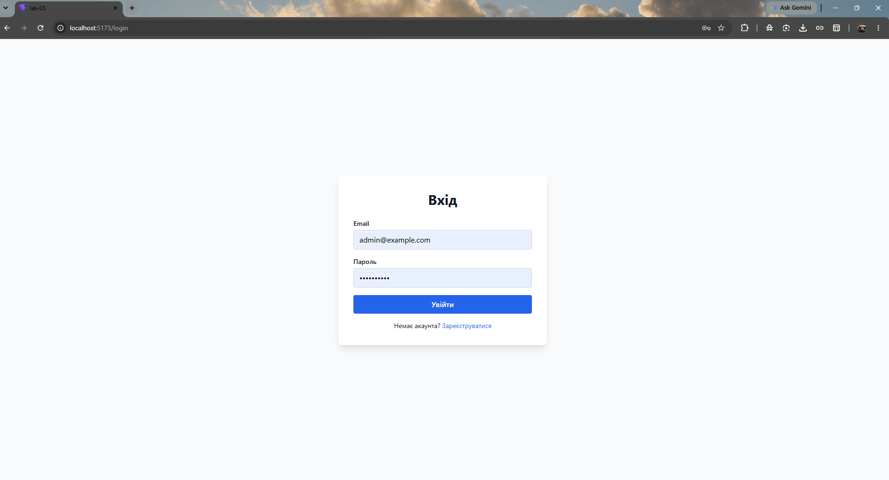
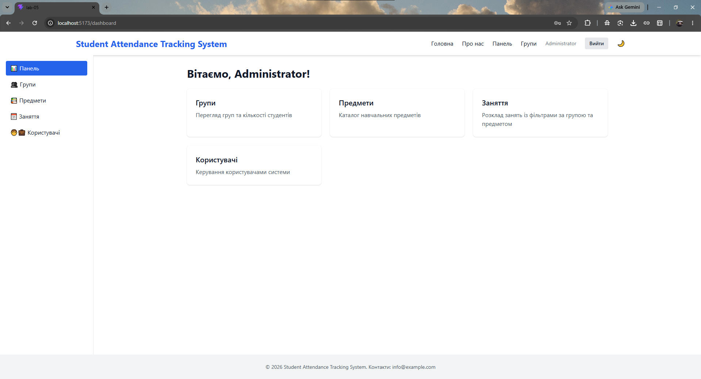
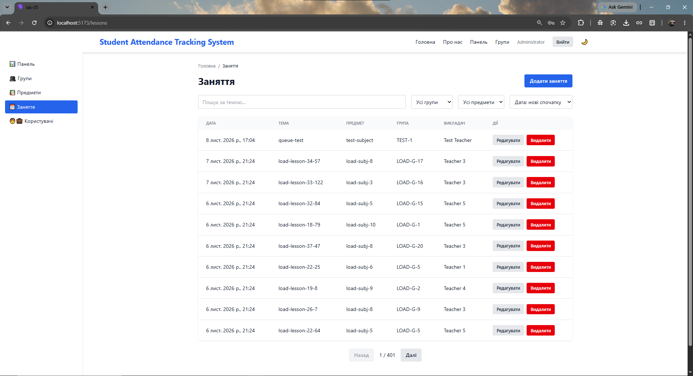
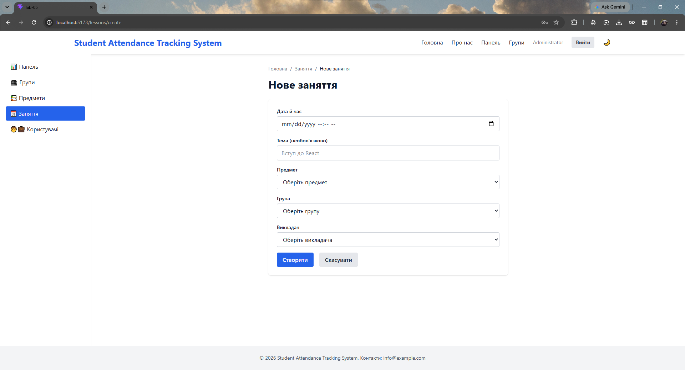
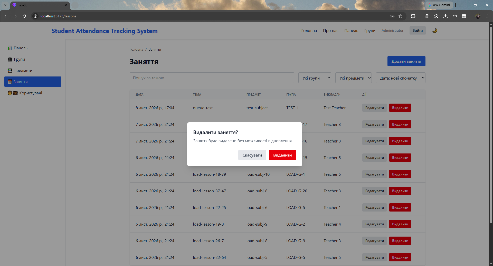
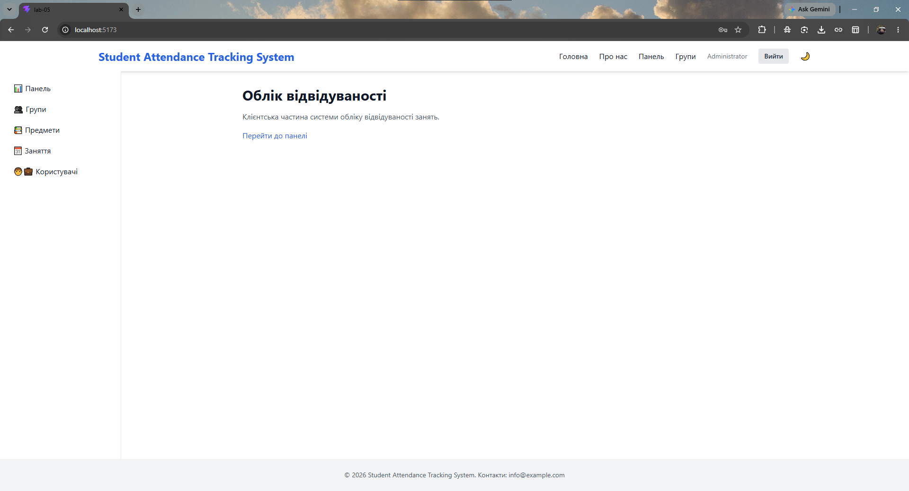
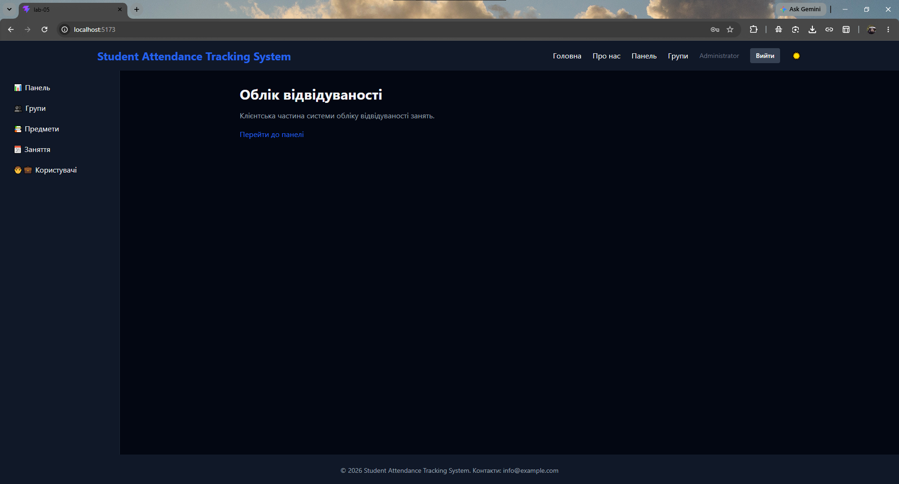

# WebDev Client (lab-05)

## Опис проєкту
Клієнтська частина (React) для системи обліку відвідуваності з лабораторних робіт 1-3. Застосунок працює з REST API серверної частини: аутентифікація (JWT), захищені маршрути, CRUD-інтерфейси для груп, предметів, занять і користувачів, валідація форм, пошук, фільтри, сортування та пагінація.

## Функціональність
- ✅ Аутентифікація (JWT): вхід, реєстрація, вихід
- ✅ Захищені маршрути (Protected Routes) і розмежування за ролями (ADMIN / TEACHER / STUDENT)
- ✅ CRUD для груп, предметів, занять і користувачів
- ✅ Валідація форм (React Hook Form + Zod 4)
- ✅ Клієнтський стан (Zustand) і дані сервера (TanStack Query)
- ✅ Сповіщення (toast) і модальне підтвердження видалення
- ✅ Пошук, фільтрація, сортування, пагінація
- ✅ Сторінки деталей (група, заняття)
- ✅ Скелетні індикатори завантаження
- ✅ Breadcrumbs, адаптивний sidebar, темна тема

## Технології
- React 19 + TypeScript
- Vite
- Tailwind CSS 4
- React Router 8
- Axios
- React Hook Form + Zod 4
- Zustand
- TanStack Query
- React Hot Toast
- ESLint + Prettier

## Встановлення та запуск

### Вимоги
- Node.js 24 LTS
- npm
- Серверна частина запущена (за замовчуванням `localhost:3000`)

### Інструкції
```bash
git clone https://github.com/Worgzz333r/WebDev-labs.git
cd WebDev-labs/lab-05
npm install
cp .env.example .env
npm run dev
```

Перевірка якості та збірка:
```bash
npm run lint
npm run build
```

## Змінні середовища

| Змінна | Опис | Приклад |
|--------|------|---------|
| `VITE_API_URL` | Адреса API серверної частини (лаб. 1-3) | `http://localhost:3000/api` |
| `VITE_APP_NAME` | Назва застосунку | `MyApp` |

## Ролі та права

| Роль | Можливості |
|------|-----------|
| ADMIN | Усе: керування користувачами, групами, предметами й заняттями |
| TEACHER | Перегляд даних, створення й редагування занять |
| STUDENT | Лише перегляд |

Захист на клієнті лише спрощує інтерфейс. Справжню перевірку прав виконує серверна частина (`authenticate` і `authorize` на маршрутах API).

## Маршрути

| Шлях | Сторінка | Доступ |
|------|----------|--------|
| `/` | Головна | усі |
| `/about` | Про нас | усі |
| `/login`, `/register` | Вхід, реєстрація | усі |
| `/dashboard` | Панель керування | авторизовані |
| `/groups`, `/groups/:id` | Список груп, деталі групи | авторизовані |
| `/groups/create`, `/groups/:id/edit` | Форма групи | ADMIN |
| `/subjects` | Список предметів | авторизовані |
| `/subjects/create`, `/subjects/:id/edit` | Форма предмета | ADMIN |
| `/lessons`, `/lessons/:id` | Список занять, деталі заняття | авторизовані |
| `/lessons/create`, `/lessons/:id/edit` | Форма заняття | ADMIN, TEACHER |
| `/users` | Список користувачів | ADMIN |
| `/users/create`, `/users/:id/edit` | Форма користувача | ADMIN |

## API-ендпоїнти, які використовує застосунок

| Метод | Адреса | Призначення |
|-------|--------|-------------|
| POST | `/auth/register` | Реєстрація |
| POST | `/auth/login` | Вхід, повертає `{ user, tokens }` |
| GET, POST | `/groups` | Список (пагінація, пошук, сортування), створення |
| GET, PUT, DELETE | `/groups/:id` | Група (з масивом студентів), зміна, видалення |
| GET, POST | `/subjects` | Список, створення |
| GET, PUT, DELETE | `/subjects/:id` | Предмет, зміна, видалення |
| GET, POST | `/lessons` | Список (фільтри за групою й предметом), створення |
| GET, PUT, DELETE | `/lessons/:id` | Заняття, зміна, видалення |
| GET, POST | `/users` | Список (фільтри за роллю й групою), створення |
| GET, PUT, DELETE | `/users/:id` | Користувач, зміна, видалення |

Списки повертаються у форматі `{ data, pagination }`.

## Структура проєкту
```
src/
├── components/
│   ├── common/      # Button, Input, Card, Badge, Loading, ErrorBoundary, ErrorMessage,
│   │                # FormField, Table, Grid, List, Breadcrumbs, Skeleton, ConfirmDialog
│   ├── layout/      # Header, Footer, Layout, Sidebar
│   └── ProtectedRoute.tsx
├── pages/           # Сторінки: вхід, реєстрація, панель, списки, форми, деталі
├── services/        # api.ts (Axios + interceptors), errors.ts, groups, subjects, lessons, users
├── stores/          # authStore (Zustand): сесія користувача
├── schemas/         # Zod-схеми валідації форм
├── hooks/           # useTheme, useDebounce, useLookups
├── types/           # Типи відповідей API
└── utils/           # Функції форматування
```

## Керування станом
- **Клієнтський стан (Zustand).** `authStore` зберігає користувача й токен доступу. Middleware `persist` пише їх у `localStorage` (ключ `auth-storage`) і відновлює після перезавантаження сторінки.
- **Дані сервера (TanStack Query).** Усі списки й записи. Ключі запитів містять параметри (`['groups', { page, search, sort }]`), тому зміна сторінки, пошуку чи сортування автоматично запускає новий запит. `keepPreviousData` не дає таблиці «блимати» між сторінками. Після створення, зміни або видалення викликається `invalidateQueries`, і сервер лишається єдиним джерелом істини.
- **Помилка 401.** Interceptor Axios очищає сесію, а `ProtectedRoute` перенаправляє на `/login`.

## Валідація форм
Усі форми побудовані на React Hook Form із Zod-схемами з `src/schemas`.
- Для полів `select` і числових полів схеми містять перетворення (`transform`, `preprocess`), тому тип входу форми (`z.input`) відрізняється від типу виходу (`z.output`).
- Схема реєстрації перевіряє збіг паролів через `refine`.
- Схема користувача має два варіанти: при створенні пароль обов'язковий, при редагуванні порожній пароль означає «не змінювати».
- Помилки сервера показуються через `setError('root', ...)` або toast.

## Компоненти

Усі базові компоненти приймають стандартні HTML-атрибути відповідного елемента (`ComponentProps`).

### Button
Props: `variant` (`primary` | `secondary` | `danger`), `size` (`sm` | `md` | `lg`), `isLoading`.
```tsx
<Button variant="danger" size="sm" onClick={handleDelete}>Видалити</Button>
<Button isLoading={isSaving}>Зберегти</Button>
```

### Input
Звичайний `<input>` зі стилями й темною темою. `ref` передається як проп (React 19), тому працює з `register` із React Hook Form.
```tsx
<Input placeholder="Пошук..." value={query} onChange={(e) => setQuery(e.target.value)} />
```

### Card
Контейнер із рамкою та тінню.
```tsx
<Card><h2>Заголовок</h2><p>Вміст</p></Card>
```

### Badge
Props: `variant` (`info` | `success` | `warning` | `danger`).
```tsx
<Badge variant="success">Активний</Badge>
```

### Loading
Індикатор завантаження. Props: `label` (необов'язковий).
```tsx
{isLoading && <Loading label="Завантаження користувачів..." />}
```

### ErrorBoundary
Перехоплює помилки відтворення дочірніх компонентів. `fallback` задає власний запасний UI.
```tsx
<ErrorBoundary fallback={<p>Помилка</p>}><Outlet /></ErrorBoundary>
```

### ErrorMessage
Базовий блок помилки з `role="alert"`. Props: `message`, `onRetry` (необов'язковий, показує кнопку «Спробувати знову»).
```tsx
{isError && <ErrorMessage message={error.message} />}
```

### FormField
Підпис, поле й повідомлення про помилку валідації. Props: `label`, `error`.
```tsx
<FormField label="Email" error={errors.email?.message}>
  <Input type="email" {...register('email')} />
</FormField>
```

### Table
Універсальна таблиця. Props: `columns` (`header`, `render`, `className`), `rows`, `getKey`.
```tsx
<Table columns={columns} rows={data.data} getKey={(l) => l.id} />
```

### Grid і List
Контейнери для колекцій записів. `Grid` дає адаптивну сітку (1, 2 або 3 колонки), `List` дає вертикальний список із розділювачами. Props однакові: `items`, `getKey`, `renderItem`.
```tsx
<Grid items={groups} getKey={(g) => g.id} renderItem={(g) => <Card>{g.name}</Card>} />
<List items={students} getKey={(s) => s.id} renderItem={(s) => <span>{s.fullName}</span>} />
```

### Breadcrumbs
Навігація «хлібні крихти». Props: `items` (`label`, `to`). Елемент без `to` позначає поточну сторінку.
```tsx
<Breadcrumbs items={[{ label: 'Головна', to: '/dashboard' }, { label: 'Групи' }]} />
```

### Skeleton, TableSkeleton, CardGridSkeleton
Скелетні індикатори завантаження для списків і карток. `TableSkeleton` приймає `rows`, `CardGridSkeleton` приймає `count`.
```tsx
{isPending && <TableSkeleton />}
```

### ConfirmDialog
Модальне вікно підтвердження на нативному `<dialog>`. Escape і клік повз вікно його закривають. Props: `open`, `title`, `message`, `confirmLabel`, `isLoading`, `onConfirm`, `onCancel`.
```tsx
<ConfirmDialog
  open={toDelete !== null}
  title="Видалити предмет?"
  message="Предмет буде видалено без можливості відновлення."
  onCancel={() => setToDelete(null)}
  onConfirm={handleDelete}
/>
```

### ProtectedRoute
Обгортка для сторінок, що вимагають входу. Неавторизованого користувача перенаправляє на `/login`, зберігаючи шлях у `state.from`, щоб після входу повернути його назад.
```tsx
<Route path="dashboard" element={<ProtectedRoute><DashboardPage /></ProtectedRoute>} />
```

### Sidebar
Бічна панель навігації. На мобільних пристроях згортається й відкривається кнопкою «Меню», закривається по Escape та кліку на затемнення. Пункт «Користувачі» бачить лише адміністратор.

## Хуки
- `useTheme()` повертає `{ theme, toggleTheme }`, вибір теми зберігається в `localStorage`.
- `useDebounce(value, delay = 300)` повертає значення із затримкою. Використовується в пошуку, щоб не надсилати запит після кожного натискання клавіші.
- `useGroupOptions()`, `useSubjectOptions()`, `useTeacherOptions()` завантажують довідники для випадаючих списків (TanStack Query, кеш 5 хвилин).

## Утиліти
- `formatDate(iso, locale?)`: дата у форматі «12 листопада 2026 р.»
- `formatPrice(value, currency?, locale?)`: сума у гривнях
- `getErrorMessage(error)`: зрозуміле повідомлення з помилки Axios

## Скріншоти

### Вхід


### Панель керування


### Список занять


### Форма створення заняття


### Модальне підтвердження видалення


### Головна, світла і темна теми



## Використання

### Тестовий обліковий запис
```
Email: [email адміністратора]
Password: [пароль]
```

## Автор
Назар, ІПЗ-42
