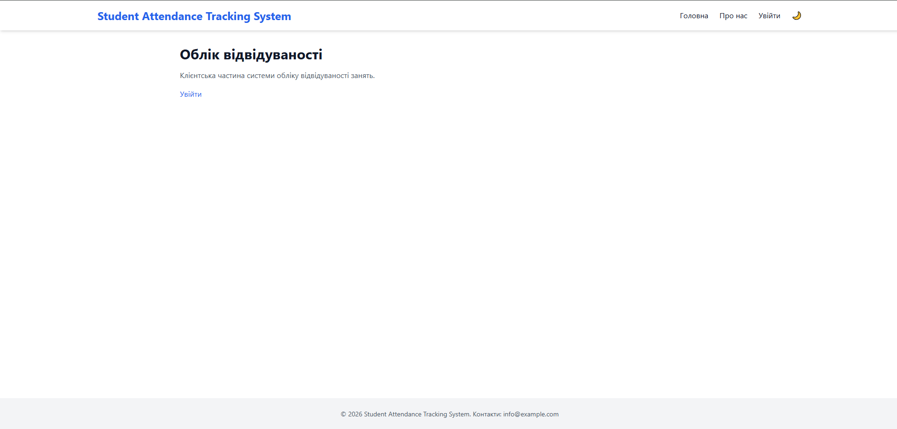
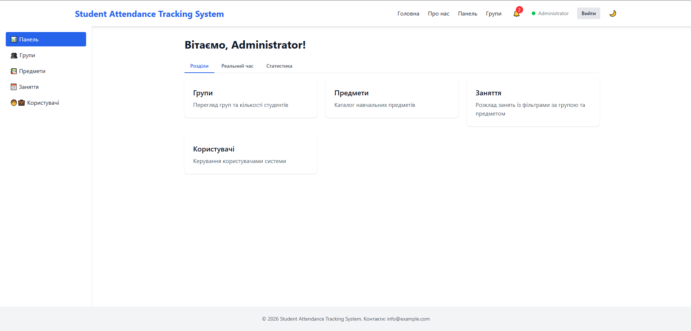
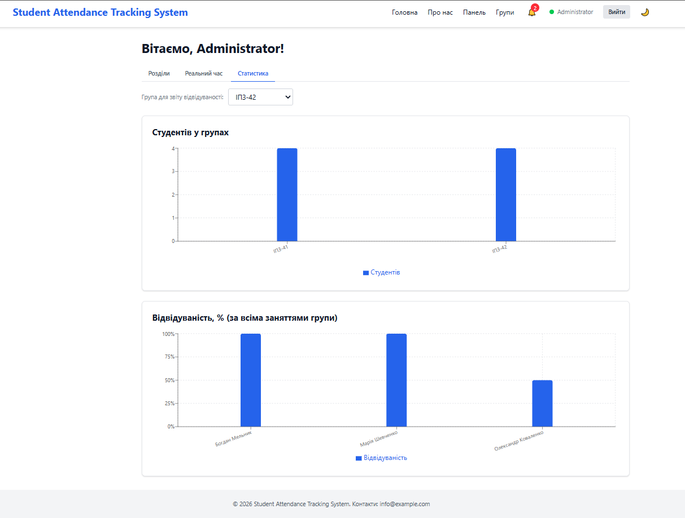
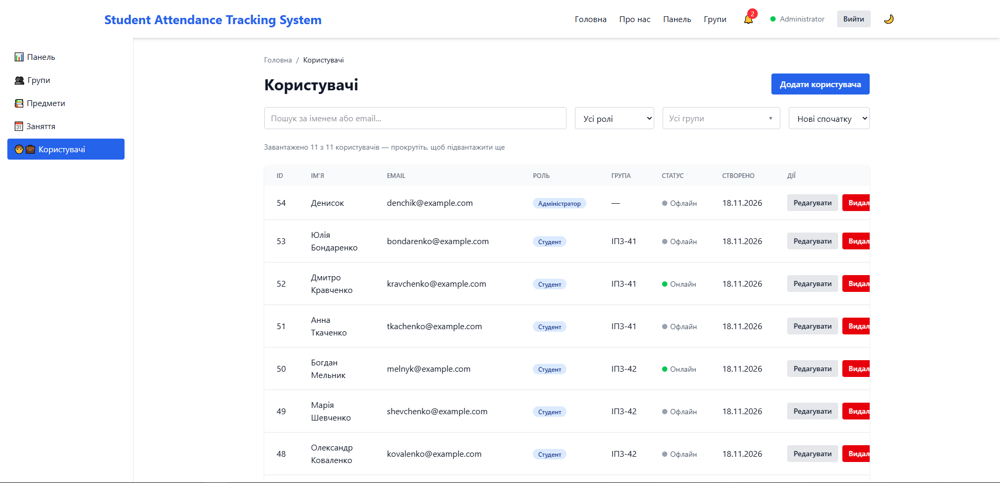
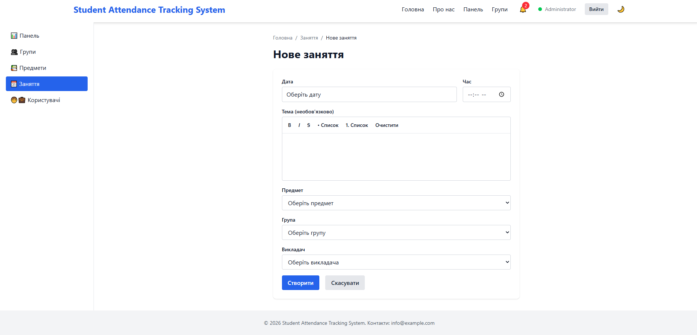
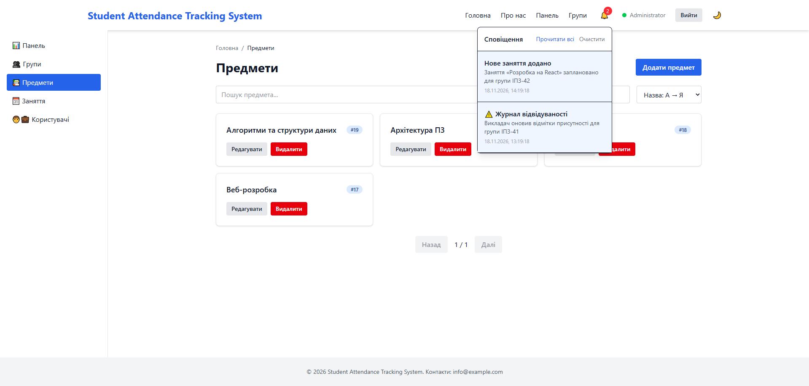
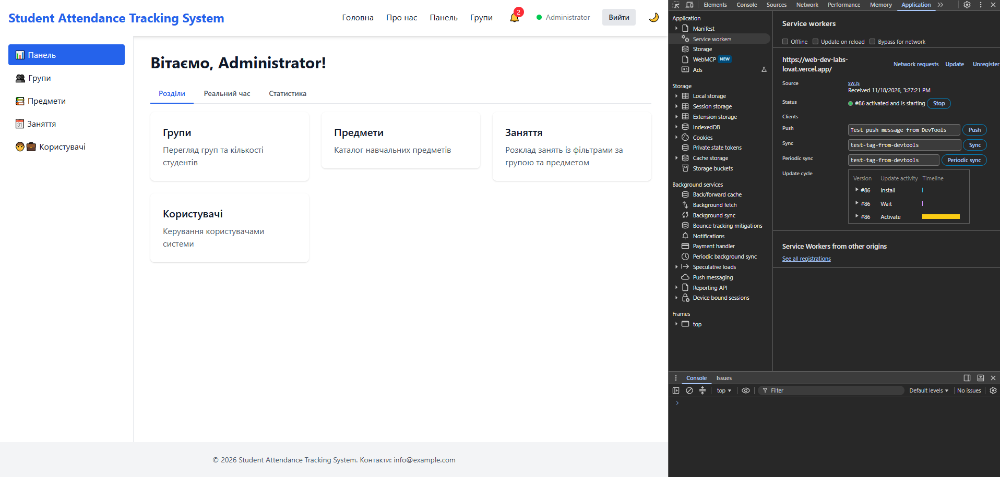
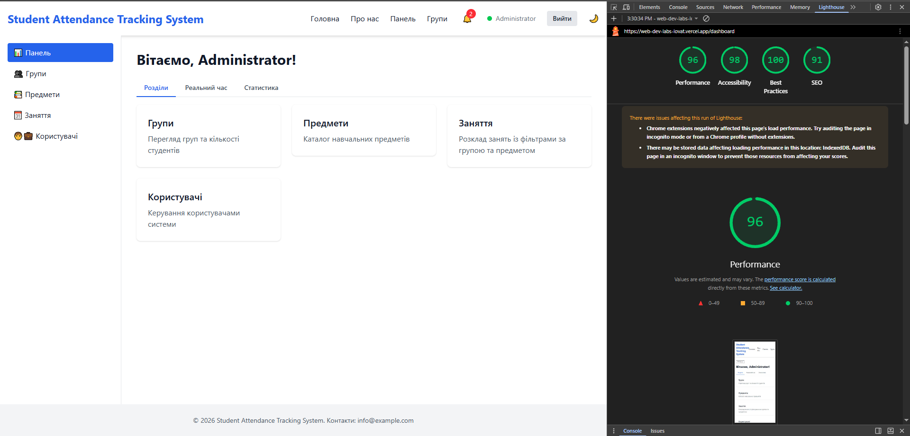

# Звіт з лабораторної роботи № 6

## Тема роботи: Реалізація розширених можливостей та розгортання клієнтської частини

**Здобувач освіти:** Генелюк Назар Олексійович  
**Група:** ІПЗ-42  
**GitHub репозиторій:** [https://github.com/Worgzz333r/WebDev-labs/tree/main/lab-06](https://github.com/Worgzz333r/WebDev-labs/tree/main/lab-06)  
**Розгорнутий клієнт (Vercel):** [https://web-dev-labs-lovat.vercel.app](https://web-dev-labs-lovat.vercel.app)  
**Розгорнутий сервер (Render):** [https://webdev-labs-omr1.onrender.com](https://webdev-labs-omr1.onrender.com)  
**Рівень складності:** 3 (Високий рівень — «відмінно»)  

---

## 🎯 Мета роботи

Здобути практичні навички впровадження функціональності реального часу (real-time) через WebSocket, створення розширених інтерактивних UI-компонентів, оптимізації продуктивності та налаштування автоматизованого розгортання React-застосунку на хостинг-платформі через CI/CD.

---

## 🛠 Реалізований функціонал

### Рівень 1. Функціональність реального часу та базові компоненти
1. **Підключення Socket.io-client (`src/services/socket.ts`):** єдиний екземпляр сокета на весь застосунок, керування підключенням у `src/hooks/useSocketConnection.ts` при зміні JWT токена.
2. **Сповіщення у реальному часі (`src/components/NotificationBell.tsx`, `src/stores/notificationsStore.ts`):** інтерактивний дзвіночок у шапці, індикація кількості непрочитаних повідомлень, розкривний список сповіщень із можливістю позначити їх прочитаними.
3. **Онлайн-статус користувачів (`src/components/OnlineStatus.tsx`, `src/stores/presenceStore.ts`):** динамічне відстеження підключень/відключень користувачів через сокет-події `user:online` та `user:offline`.
4. **Оновлення списків у реальному часі (`src/hooks/useRealtimeSync.ts`):** інвалідація запитів TanStack Query (`queryClient.invalidateQueries`) при отриманні подій зміни даних на сервері.
5. **Модальні вікна підтвердження (`src/components/common/Modal.tsx`, `src/components/common/ConfirmDialog.tsx`):** доступні модальні діалоги на базі Headless UI v2 з блокуванням фокусу, закриттям через `Escape` та анімацією станів.
6. **Компонент табів (`src/components/common/Tabs.tsx`):** перемикання розділів на базі `TabGroup` з Headless UI.
7. **Випадне меню з пошуком (`src/components/common/SearchableSelect.tsx`):** вибір елементів із динамічною фільтрацією.

### Рівень 2. Розширені інтерактивні елементи
8. **Drag and Drop (`src/pages/DashboardPage.tsx`):** сортування карток розділів за допомогою `@dnd-kit/core` та `@dnd-kit/sortable` з підтримкою клавіатурної навігації (доступність).
9. **Візуалізація даних і графіки (`src/components/common/StatsChart.tsx`, `src/components/dashboard/StatsSection.tsx`):** побудова лінійних графіків розподілу студентів та відсотків відвідуваності на базі Recharts.
10. **Нескінченне прокручування (`src/pages/UsersPage.tsx`):** завантаження списку користувачів за допомогою `useInfiniteQuery` та сторожового елемента з `IntersectionObserver`.
11. **Завантаження зображень з обрізанням (`src/components/attendance/CropUploadDialog.tsx`):** попередній перегляд і кадрування фотографій документів за допомогою `react-easy-crop`.
12. **Календар вибору дати (`src/components/common/DatePickerField.tsx`):** спливаючий календар `react-day-picker` з українською локалізацією.
13. **Розширений текстовий редактор (`src/components/common/RichTextEditor.tsx`):** редагування теми заняття через Tiptap (`@tiptap/starter-kit`) із санітизацією DOMPurify.
14. **Анімації переходів (`src/components/common/PageTransition.tsx`):** плавні анімації переходів між маршрутами на базі Motion.

### Рівень 3. Оптимізація та розгортання
15. **Розбиття коду (Code Splitting):** динамічний імпорт усіх сторінок через `React.lazy()` та обгортка `Suspense` з `Loading` у `src/App.tsx`.
16. **Аналіз розміру збірки:** підключено `rollup-plugin-visualizer` у `vite.config.ts` для контролю розміру чанків.
17. **Progressive Web App (PWA):** налаштовано `vite-plugin-pwa` з маніфестом, іконками та сервіс-воркером зі стратегією `NetworkFirst` для API-запитів.
18. **Кешування на клієнті (`src/lib/queryClient.ts`):** налаштовано персистенцію кешу TanStack Query у `localStorage` для довідкових даних.
19. **SEO-оптимізація (`index.html`):** метатеги опису, `theme-color`, теги Open Graph (og:title, og:description, og:image, og:url).
20. **CI/CD конвеєр (`.github/workflows/deploy.yml`):** GitHub Actions автоматично проводить лінтинг, тестування (`npm test`), збірку та розгортання на Vercel при push у гілку `main`.
21. **Розгортання у Production:** клієнтська частина успішно розгорнута на Vercel, налаштовано SPA-rewrite у `vercel.json` та коректні змінні оточення `VITE_API_URL` і `VITE_SOCKET_URL`.
22. **Автоматизоване тестування:** написано модульні тести для `NotificationBell` та `ConfirmDialog` на базі Vitest та React Testing Library (5/5 тестів успішні).

---

## 📸 Скріншоти виконання

### 1. Головна сторінка

### 2. Панель керування (Dashboard з перетягуванням карток)

### 3. Графіки статистики (Recharts)

### 4. Робота зі списками (CRUD)

### 5. Форма створення заняття (Календар + Rich Text)

### 6. Сповіщення в реальному часі (Дзвіночок)

### 7. Підтримка PWA (Service Worker)

### 8. Аудит продуктивності (Lighthouse)

---

## ❓ Відповіді на контрольні запитання

### 1. Поясніть різницю між WebSocket та HTTP. Коли доцільно використовувати WebSocket, а коли достатньо HTTP?
**HTTP** — це протокол типу «запит-відповідь» (request-response) у форматі напівдуплексу (half-duplex), де ініціатором з'єднання завжди виступає клієнт. Для отримання свіжих даних без WebSocket доводиться використовувати періодичний polling, що створює значний надлишковий трафік заголовків.  
**WebSocket** — це повнодуплексний (full-duplex) протокол поверх одного TCP-з'єднання. Після рукостискання (HTTP upgrade handshake) з'єднання лишається відкритим, дозволяючи серверу миттєво надсилати дані клієнту без попереднього запиту з мінімальним оверхедом (кадри розміром кілька байтів).  
- **Коли достатньо HTTP:** для стандартних операцій створення/читання/оновлення/видалення даних (REST API), разових запитів, завантаження статичних файлів і сторінок.  
- **Коли потрібен WebSocket:** для чатів, сповіщень у реальному часі, живих панелей моніторингу/біржових котирувань, спільного редагування документів та багатокористувацьких ігор.

### 2. Як правильно керувати життєвим циклом з'єднання Socket.io в React-застосунку? Чому з'єднання створюють один раз, а не в кожному компоненті, і чому важливо знімати власний обробник події?
- **Єдине з'єднання:** екземпляр сокета ініціалізується один раз на рівні застосунку (наприклад, у модулі `socket.ts` з опцією `autoConnect: false`), а підключення/відключення прив'язується до наявності JWT-токена в кореневому макеті (`Layout`). Створення нового сокета в кожному компоненті призводило б до лавини одночасних TCP-з'єднань при кожному рендері/переході сторінок та перевантаження сервера.  
- **Очищення підписок:** кожен компонент реєструє обробник через `socket.on(event, handler)` у хуку `useEffect`. У функції очищення (cleanup) необхідно викликати саме `socket.off(event, handler)`, передаючи точне посилання на функцію. Якщо викликати `socket.off(event)` без другого аргументу, це видалить слухачі всіх інших компонентів у застосунку, а якщо не викликати взагалі — виникне витік пам'яті (memory leak) та дублювання викликів обробника.

### 3. Що таке портали React і як вони використовуються для модальних вікон? Які вимоги доступності має виконувати модальне вікно?
**React Portal (`createPortal`)** дозволяє відрендерити дочірній DOM-вузол у довільне місце в DOM-дереві (зазвичай наприкінці `document.body`), зберігаючи при цьому доступ до React Context та механізм спливання подій (event bubbling). Це усуває проблеми з CSS-властивостями батьківських контейнерів (`overflow: hidden`, `z-index`, `transform`, які можуть обрізати або неправильно позиціонувати модальне вікно).  
**Вимоги доступності (a11y) для модалок:**
1. Наявність семантичних ARIA-атрибутів: `role="dialog"`, `aria-modal="true"`, `aria-labelledby`, `aria-describedby`.
2. Утримання фокусу (Focus Trap) всередині вікна, щоб клавіша `Tab` не виходила на прихований фоновий контент.
3. Закриття вікна після натискання клавіші `Escape`.
4. Блокування прокручування сторінки під модальним вікном (`overflow: hidden` на `body`).
5. Повернення фокусу на елемент, що відкрив модальне вікно, після його закриття.

### 4. Порівняйте бібліотеки для перетягування елементів у React. Які переваги має dnd-kit і як забезпечується доступність з клавіатури?
- **react-dnd:** тривалий час була стандартом, має концепцію drag sources і drop targets, але спирається на нативний HTML5 Drag and Drop API, що робить її складною в налаштуванні для сенсорних пристроїв і практично покинутою у розвитку.
- **dnd-kit:** сучасна модульна бібліотека з хуками (`useDraggable`, `useDroppable`, `useSortable`), легка, оптимізована під 60 FPS через використання CSS Transforms замість постійного перерендеру DOM.  
**Доступність з клавіатури в dnd-kit:** досягається за рахунок підключення `KeyboardSensor` із функцією `sortableKeyboardCoordinates`. Користувач може сфокусуватися на елементі за допомогою `Tab`, натиснути `Пробіл` для захоплення елемента, переміщати його стрілками клавіатури (`Вгору`/`Вниз`/`Вліво`/`Вправо`) і зафіксувати нову позицію повторним натисканням `Пробілу` або скасувати дію клавішею `Escape`.

### 5. Поясніть концепцію розбиття коду. Як працюють `React.lazy()` і `Suspense` та як збирач формує окремі chunks?
**Розбиття коду (Code Splitting)** — це розділення єдиного монолітного JS-бандла на декілька дрібніших файлів (chunks), які завантажуються браузером асинхронно лише тоді, коли вони реально потрібні.  
- **Робота збирача (Vite/Rolldown):** коли збирач бачить динамічний виклик `import('./MyComponent')`, він автоматично виносить цей компонент та його унікальні залежності в окремий `.js` файл у каталозі `dist/assets/`.
- **`React.lazy()`:** функція-обгортка, яка перетворює динамічний імпорт на повноцінний React-компонент, що завантажується ліниво під час першого монтування.
- **`Suspense`:** компонент, який перехоплює стан очікування завантаження проміса від `React.lazy()` та відображає запасний інтерфейс (fallback, наприклад спінер чи скелетон), доки чанк завантажується по мережі.

### 6. Що таке Service Worker і як він забезпечує офлайн-функціональність у PWA? Чим відрізняються стратегії `CacheFirst`, `NetworkFirst` і `StaleWhileRevalidate` та коли застосовувати кожну?
**Service Worker** — це фоновий скрипт браузера, що працює в окремому потоці (Worker thread), незалежно від веб-сторінки, і виступає проксі-сервером між клієнтом і мережею, здатним перехоплювати всі HTTP-запити (`fetch` event).  
**Стратегії кешування:**
1. **`CacheFirst` (Кеш спершу):** запит шукається в кеші браузера. Якщо знайдено — повертається миттєво. Якщо ні — завантажується з мережі та зберігається в кеш. Ідеально підходить для незмінних статичних файлів з хешами в іменах (JS-чанки, CSS, шрифти, логотипи).
2. **`NetworkFirst` (Мережа спершу):** спершу робиться спроба дістати актуальні дані з сервера. Якщо мережа відсутня чи запит перевищив таймаут — віддається остання збережена версія з кешу. Ідеально для API-запитів динамічних даних.
3. **`StaleWhileRevalidate` (Віддай з кешу й онови):** клієнту негайно віддається поточна копія з кешу, і паралельно у фоні надсилається запит до мережі для оновлення кешу на наступний раз. Ідеально для аватарів користувачів, статей або статичних списків, де важлива швидкість відповіді, але допустима незначна затримка свіжості.

### 7. Які метрики продуктивності важливі для вебзастосунків (LCP, INP, CLS)? Як їх виміряти та покращити?
**Core Web Vitals:**
- **LCP (Largest Contentful Paint):** час завантаження найбільшого видимого елемента контенту на екрані (ціль: < 2.5 с). Покращується через стиснення картинок (WebP/AVIF), правильні розміри, усунення блокуючого JS/CSS та використання CDN.
- **INP (Interaction to Next Paint):** час затримки інтерфейсу у відповідь на дії користувача (кліки, введення тексту) до моменту відмалювання наступного кадру (ціль: < 200 мс). Покращується через розбиття важких завдань у JS, використання `startTransition`, мемоізацію та уникнення блокування основного потоку (Main Thread).
- **CLS (Cumulative Layout Shift):** сумарний показник неочікуваних зсувів верстки під час завантаження (ціль: < 0.1). Покращується вказуванням фіксованих розмірів (`width`, `height`, `aspect-ratio`) для зображень і відео та використанням скелетонів (`Skeleton`) під розмір майбутнього контенту.  
*Вимірюються:* через Chrome DevTools (вкладка Lighthouse та Performance), PageSpeed Insights або утиліту `web-vitals`.

### 8. Порівняйте Vercel та Netlify для розгортання React-застосунків. Навіщо SPA потрібне правило перезапису на `index.html` і чому змінні `VITE_*` потребують повторної збірки?
Обидві платформи надають безкоштовний хостинг для статичних фронтендів з автоматичним CI/CD з GitHub, глобальною мережею CDN та SSL-сертифікатами. Vercel має дещо швидшу збірку і тіснішу інтеграцію з екосистемою Next.js, тоді як Netlify надає гнучкіші плагіни збірки та налаштування заголовків через `netlify.toml`.  
- **SPA Rewrite:** в односторінкових застосунках маршрутизація (`/lessons`, `/dashboard`) є клієнтською (віртуальною). Веб-сервер за замовчуванням сприймає адресу `/lessons` як фізичний каталог і повертає помилку 404. Правило перезапису (`rewrites: [{ source: "/(.*)", destination: "/index.html" }]` у `vercel.json`) наказує серверу завжди віддавати `index.html`, після чого React Router підхоплює URL у браузері.
- **Змінні `VITE_*`:** компілятор Vite підставляє змінні оточення **статично під час білду** шляхом заміни тексту `import.meta.env.VITE_VAR` на конкретні рядкові літерали. Вони не читаються в рантаймі браузера, тому зміна змінної вимагає обов'язкової повторної збірки застосунку.

### 9. Що таке CI/CD і які переваги дає автоматизація розгортання? Чому розгортання виконують лише після успішних тестів і лише з головної гілки?
**CI (Continuous Integration)** — автоматична збірка, лінтинг та запуск тестів при кожному пуші чи створенні Pull Request для виявлення дефектів на ранніх етапах.  
**CD (Continuous Deployment)** — автоматичний реліз та розгортання працездатної версії на бойовий сервер без ручного втручання.  
- **Чому розгортання лише після тестів:** якщо розгортати код одразу, будь-яка синтаксична помилка, зламаний API-клієнт або збій збірки одразу потраплять до кінцевих користувачів, зламавши працездатність сайту. Тести виступають захисним бар'єром (quality gate).
- **Чому лише з головної гілки (`main`):** стабільний стан системи фіксується в основній гілці після рев'ю та перевірок; експериментальний або незавершений код із feature-гілок не повинен перезаписувати робочий продакшн.

### 10. Як забезпечити SEO для односторінкових застосунків і в яких випадках потрібні SSR або генерація статичних сторінок?
Для базового SPA достатньо:
1. Заповнення метатегів у `index.html` (`<title>`, `<meta name="description">`, `lang="uk"`).
2. Налаштування протоколу Open Graph (`og:title`, `og:description`, `og:image`, `og:url`) для привабливих прев'ю у соцмережах і месенджерах.
3. Додавання файлів `robots.txt` та `sitemap.xml`.  
- **Коли потрібен SSR (Server-Side Rendering) або SSG (Static Site Generation):** для контентних платформ, блогів, публічних інтернет-магазинів та новинних ресурсів, де індексація пошуковими ботами (Googlebot, Bing) є критичною для бізнесу. Пошукові боти хоч і вміють виконувати JS, роблять це із затримкою та менш надійно; при SSR сервер одразу віддає повністю готовий HTML-код із контентом, що гарантує 100% швидку та коректну індексацію.
